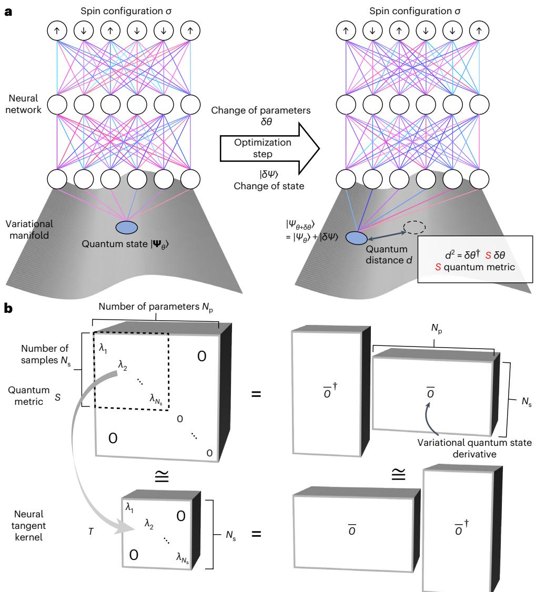
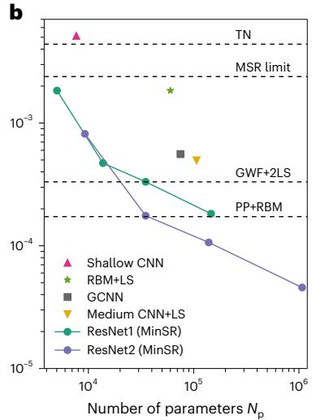
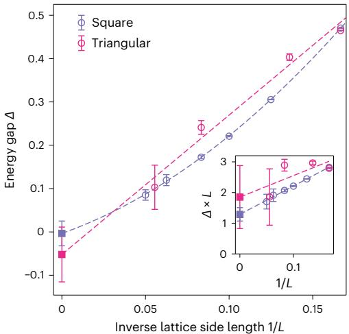

# MinSR：把深度神经量子态的优化从参数空间搬到样本空间

## 论文信息与核心贡献

- **标题**：Empowering deep neural quantum states through efficient optimization
- **作者与单位**：Ao Chen、Markus Heyl；德国奥格斯堡大学电子关联与磁学中心。
- **发表**：*Nature Physics* **20**, 1476–1481（2024）；2024 年 7 月 1 日在线发表。
- **原文**：[DOI: 10.1038/s41567-024-02566-1](https://doi.org/10.1038/s41567-024-02566-1)；[arXiv:2302.01941](https://arxiv.org/abs/2302.01941)。
- **复现资源**：[MinSR 代码](https://github.com/ChenAo-Phys/MinSR)；[数据、权重与代码存档](https://doi.org/10.5281/zenodo.7657551)。
- **阅读范围**：正式发表版主文、Methods、Extended Data Figs. 1–4 与 Table 1，以及源 PDF 所附 Supplementary Information A–D；图号与数值均按该版本核对。

**这篇论文解决了深度神经量子态“网络可以做大，几何优化怎样跟上”的问题。** 作者提出 minimum-step stochastic reconfiguration（MinSR）：保留随机重构 SR 对量子态几何的处理，把求解核心从参数数量决定的大矩阵改写为样本数量决定的小矩阵。它支持训练达 64 个卷积层、超过百万参数的网络，并将二维受挫磁体的变分计算推进到更高精度。

最有说服力的结果是方法、精度和物理问题形成了同一条论证链：MinSR 使大网络可训练；增大网络持续改善基态能量；高精度基态与激发态计算进一步支持方格、三角格 $J_1$–$J_2$ 模型中的无隙自旋液体图景。理解本文应抓住这条主线：**通过更高效的几何优化，把深网络的表达能力转化为可用的多体物理精度。**

## 一、问题入口：为什么 NQS 需要的不只是更大的网络

神经量子态（neural quantum state，NQS）用网络表示多体波函数的振幅：

$$
\ket{\Psi_\theta}=\sum_\sigma\psi_\theta(\sigma)\ket{\sigma},
\qquad
E_\theta=\frac{\bra{\Psi_\theta}H\ket{\Psi_\theta}}
{\bra{\Psi_\theta}\ket{\Psi_\theta}}.
$$

输入 $\sigma$ 是自旋构型，网络输出 $\psi_\theta(\sigma)$。变分蒙特卡洛（VMC）按 $p_\theta(\sigma)\propto|\psi_\theta(\sigma)|^2$ 采样，用局域能量估计 $E_\theta$，再更新参数。整个计算在经典计算机上进行，网络承载的是波函数本身。

Carleo 与 Troyer 的 2017 年工作确立了这一框架。深网络继续增加表达能力，却引出了训练成本：适用于 NQS 的 SR 需要处理参数空间中的量子度量。若参数数目为 $N_p$，显式构造该矩阵需要 $N_p^2$ 级存储，稠密分解通常需要 $N_p^3$ 级运算。深网络的规模增长因此首先挑战优化器。

本文识别出一个关键结构：**当每步样本数 $N_s$ 小于参数数 $N_p$，当前批次能够约束的态变化方向远少于网络的参数方向。** 既然样本已经限定了有效信息维数，就可以在样本空间中完成同样的几何更新。（主文 Results；Fig. 1）

## 二、从虚时间演化推导 SR：真正需要匹配的是什么

### 1. 参数变化对应切空间中的态变化

虚时间演化 $e^{-H\delta\tau}\ket{\Psi_\theta}$ 逐步压低高能分量。SR 要做的是：在当前变分流形的切空间里，寻找最接近这一演化方向的参数更新。

对每个样本构型定义对数导数和局域能量：

$$
O_{\sigma k}=\frac{\partial\log\psi_\theta(\sigma)}{\partial\theta_k},
\qquad
E_{\mathrm{loc}}(\sigma)=
\sum_{\sigma'}H_{\sigma\sigma'}
\frac{\psi_\theta(\sigma')}{\psi_\theta(\sigma)}.
$$

将样本均值记为 $\langle\cdot\rangle_s$，引入中心化、归一化的量

$$
\bar O_{\sigma k}=\frac{O_{\sigma k}-\langle O_k\rangle_s}{\sqrt{N_s}},
\qquad
\bar\epsilon_\sigma=-\frac{\delta\tau}{\sqrt{N_s}}
\left(E_{\mathrm{loc}}(\sigma)-\langle E_{\mathrm{loc}}\rangle_s\right).
$$

中心化去除了平行于原态的变化，使比较发生在归一化量子态的射影几何中。补充材料 A 从 Fubini–Study 距离出发，得到一阶态变化对应的最低阶距离：

$$
d^2\simeq\left\|\bar O\,\delta\theta-\bar\epsilon\right\|_2^2.
$$

左侧向量是参数更新能够产生的采样态变化，右侧是虚时间演化要求的变化。优化任务由此变成一个明确的最小二乘问题。

### 2. SR 在参数空间求解

传统 SR 的正规方程为

$$
S\,\delta\theta=F,
\qquad
S=\bar O^\dagger\bar O,
\qquad
F=\bar O^\dagger\bar\epsilon.
$$

$S$ 是对数导数的协方差矩阵，也是采样估计下的量子几何张量。它让更新方向考虑“参数变化会使物理态改变多少”，而不直接依赖参数坐标中的欧氏梯度。这是 SR 能处理复杂 NQS 优化的关键价值；MinSR 要保留的正是这一结构。

## 三、MinSR 的核心：同一组非零奇异方向，两种矩阵表示

### 1. 从 $N_p\times N_p$ 改为 $N_s\times N_s$

采样 Jacobian $\bar O$ 的形状是 $N_s\times N_p$。除了参数空间的 $S$，还可构造样本空间的核矩阵

$$
T=\bar O\bar O^\dagger.
$$

若 $\bar O=U\Sigma V^\dagger$，那么

$$
S=V\Sigma^\dagger\Sigma V^\dagger,
\qquad
T=U\Sigma\Sigma^\dagger U^\dagger.
$$

两者保留相同的非零奇异值平方，分别用参数方向和样本方向描述同一个切空间。作者将 $T$ 称为 neural tangent kernel（神经切线核）。MinSR 的更新是

$$
\boxed{\delta\theta=\bar O^\dagger T^+\bar\epsilon}
$$

其中 $+$ 表示 Moore–Penrose 伪逆。先求样本空间系数，再用 $\bar O^\dagger$ 把它映射回参数空间，即可完成更新。（主文式 1–3；Methods）

> 图 1 将量子态几何与矩阵形状联系起来：大矩阵 $S$ 中有效的非零谱信息，可以由小矩阵 $T$ 保留。

### 2. “minimum-step” 为什么有意义

当 $N_p\gg N_s$，许多参数更新能够实现相同的采样态变化。MinSR 在使残差最小的所有解中，选择 $\|\delta\theta\|_2$ 最小的一个：

$$
\delta\theta=\bar O^+\bar\epsilon
=(\bar O^\dagger\bar O)^+\bar O^\dagger\bar\epsilon
=\bar O^\dagger(\bar O\bar O^\dagger)^+\bar\epsilon.
$$

最后两个表达式分别对应 SR 和 MinSR。**算法的加速来自线性代数表示的改变，同时明确选定最小范数更新。** 这样可以避免加入当前样本无法约束的零空间分量，并控制参数大幅移动带来的高阶影响。

伪逆在这里也是数学定义的一部分。由于样本中心化，$\bar O$ 的行和为零，故其秩至多为 $N_s-1$；相应的 $T$ 本身有零模。写成普通逆时，应理解为对有效子空间求逆。这个处理对阅读公式和实现算法都很重要。

## 四、数值实现：软截断与复波函数怎样接入

### 1. 在可靠谱方向上更新

作者要求从构造 $T$ 开始采用双精度计算，以可靠分辨小特征值。令 $T=UDU^\dagger$，特征值为 $\lambda_i$。实际求解使用平滑谱滤波：

$$
\lambda_i^+=\left[
\lambda_i\left(1+
\left(\frac{r_{\mathrm{pinv}}|\lambda_{\max}|+a_{\mathrm{pinv}}}
{|\lambda_i|}\right)^6\right)
\right]^{-1},
\qquad
T^+=UD^+U^\dagger.
$$

零特征值对应的逆取零。多数计算使用 $r_{\mathrm{pinv}}=10^{-12}$、$a_{\mathrm{pinv}}=0$。滤波保留可靠方向，平滑压低接近阈值的方向，避免特征值穿越硬截断时引发更新跳变。它使最小范数原则成为稳定的数值方案。（Methods，式 20–23）

### 2. 实参数、复输出时扩展样本方程

原始复数公式适用于全纯复网络，实网络则直接使用实数版本。若参数为实数而输出为复数，应对实部、虚部分别匹配：

$$
\bar O'=\begin{pmatrix}\operatorname{Re}\bar O\\\operatorname{Im}\bar O\end{pmatrix},
\qquad
\bar\epsilon'=\begin{pmatrix}\operatorname{Re}\bar\epsilon\\\operatorname{Im}\bar\epsilon\end{pmatrix},
\qquad
\delta\theta=\bar O'^T(\bar O'\bar O'^T)^+\bar\epsilon'.
$$

样本空间矩阵由此扩为 $2N_s\times2N_s$。对应的参数空间方程是 $\operatorname{Re}S\,\delta\theta=\operatorname{Re}F$。这一扩展使同一方法可训练三角格和非零动量激发态所需的复波函数。（Methods，式 24–27）

## 五、加速发生在哪里：参数更多，矩阵不必随之平方增长

| 计算对象 | 参数空间 SR：显式稠密方案 | 样本空间 MinSR |
|---|---|---|
| 需要分解的矩阵 | $N_p\times N_p$ 的 $S$ | $N_s\times N_s$ 的 $T$ |
| 构造矩阵 | $O(N_sN_p^2)$ | $O(N_pN_s^2)$ |
| 稠密分解 | $O(N_p^3)$ | $O(N_s^3)$ |
| 核心适用关系 | 参数空间规模可控 | $N_p\gg N_s$ |

表中的立方成本对应显式稠密 SR。SR 也可以采用矩阵自由的迭代求解：例如 Carleo–Troyer 使用基于 Lanczos 的 MINRES-QLP，无需显式保存完整度量矩阵。MinSR 的独特之处是直接改写求解所在的空间，并用样本核的谱分解控制有效方向。

因而 MinSR 线性代数部分的总成本为 $O(N_pN_s^2+N_s^3)$：固定每步样本数时，对参数数目呈线性增长。Extended Data Fig. 1 进一步比较直接求解、迭代求解与 MinSR 的时间、残差和训练轨迹；其百万参数训练对照使用 $N_s=10^4$。这组证据把代数改写与实际可训练规模联系起来。

补充材料 B 还讨论了完整 VMC 迭代。设一次网络前向传播成本为 $F$，对称群阶数为 $|G|$，格点数为 $N_{\mathrm{site}}$。对文中的局域自旋模型，采样和局域能量计算通常贡献

$$
O\!\left(N_s|G|F N_{\mathrm{site}}\right),
$$

卷积网络中 $F=O(N_pN_{\mathrm{site}})$。MinSR 消除了显式参数度量分解对大网络的制约，使主要成本转到这些物理求值环节。“对参数数目线性”描述固定样本等条件下的优化成本；系统尺寸增大时，网络、采样和精度需求需要共同计算。

内存方面，可以逐层计算 $T=\sum_l\bar O^{(l)}\bar O^{(l)\dagger}$，释放已经使用的 Jacobian，再结合梯度检查点控制中间激活的存储。这样无需同时保存整个 $N_s\times N_p$ Jacobian；$N_s\times N_s$ 的核矩阵仍需计入内存预算。这些工程细节使样本空间改写在 GPU 上具有实际价值。

## 六、怎样把优化能力转化为基态精度

测试模型为周期边界条件下的自旋 $1/2$ Heisenberg 模型：

$$
H=J_1\sum_{\langle i,j\rangle}\mathbf S_i\cdot\mathbf S_j
+J_2\sum_{\langle\!\langle i,j\rangle\!\rangle}\mathbf S_i\cdot\mathbf S_j,
\qquad J_1=1.
$$

作者使用两类残差卷积网络。ResNet1 包含层归一化、ReLU 与卷积，便于从小系统迁移到大系统；ResNet2 去掉归一化层，支持实、复输出和非零动量。计算还结合格点与自旋反演对称性投影、物理符号结构及部分结果中的一步 Lanczos 改进。这些设计共同构成最终求解器。

| 基准任务 | 本文报告的结果 | 在论证中的作用 |
|---|---|---|
| $6\times6$，无挫折与受挫方格 | 64 层、146,320 参数；对称化 Hilbert 空间维数 15,804,956 | 与精确对角化的波函数振幅直接核对 |
| $10\times10$，$J_2/J_1=0$ | $E/N=-0.67155260(3)$ | 相对能量误差达到约 $10^{-7}$ |
| $10\times10$，$J_2/J_1=0.5$ | 最佳变分能量 $E/N=-0.4976921(4)$ | 百万参数深网络改善受挫基态精度 |
| 同一受挫模型 | 零方差外推 $E_{\mathrm{GS}}/N=-0.497715(9)$ | 为能量误差和物理分析提供参考估计 |
| $16\times16$，$J_2/J_1=0.5$ | $E/N=-0.4967163(8)$ | 展示精度优势延续到更大二维系统 |

无挫折基准的参考能量由作者的随机级数展开计算给出，为 $-0.67155267(5)$。受挫 $10\times10$ 模型中，作者报告相对误差较此前最佳结果缩小约四倍。小系统的“接近机器精度”则具体指 Extended Data Fig. 2 中接近 TF32 或 BF16 的精度尺度，应与大系统的能量结果分别理解。

> 图 2b 的主证据是连续的规模趋势：两个深网络的能量误差都随参数增加而降低，ResNet2 从约万参数推进到百万参数时，曲线持续向更高精度移动。

图中 MSR limit 的 MSR 指 **Marshall sign rule**，与随机重构 SR 是不同概念。它标记固定该符号结构时的能量参照。深网络结果跨越这条参照，说明网络在受挫模型中学习到了更丰富的符号修正。图 2 中不同网络、对称性处理和 Lanczos 后处理对应各自方案；其中无挫折面板引入的张量网络虚线采用开放边界，应按图注给定口径理解。

## 七、物理收获：用更准确的能量差探查无隙自旋液体

作者计算 singlet 基态与指定动量 triplet 激发态的总能量差 $\Delta$。方格取 $J_2/J_1=0.5$、激发态动量 $(\pi,\pi)$；三角格取 $J_2/J_1=0.125$、动量 $(4\pi/3,0)$。

| 模型 | 计算系统 | 外推形式 | 热力学极限截距 |
|---|---|---|---|
| 方格 | $L=6,8,10,12,16,20$ | $\Delta=a+b/L+c/L^2$ | $0.00(3)$ |
| 三角格 | $6\times6,6\times9,12\times12,18\times18$ | $\Delta=a+b/L$，$L=\sqrt{L_xL_y}$ | $-0.05(6)$ |

两个截距均与零相容；三角格负中心值按外推统计误差理解。图中 $\Delta L$ 随 $1/L$ 趋于有限值，与 $\Delta\propto1/L$ 的无隙图景一致。作者据此给出支持无隙量子自旋液体的数值证据。（Fig. 3）

> 图 3 同时展示带隙外推与 $\Delta L$ 标度。两种展示指向同一物理信息：能隙随系统线性尺寸增大而闭合。

为准确比较两个扇区，论文先使用不同网络规模及一步 Lanczos 结果，对基态和激发态分别做零方差外推。接近本征态时，能量偏差与方差具有近似线性关系；降低方差并外推到零，可以控制两种态变分误差不同造成的能隙偏移。补充材料 D 用处理前后的结果展示了这一作用。

这一外推可以从简单的态分解理解。设归一化近似态为

$$
\ket{\psi}=\sqrt{1-\eta^2}\ket{g}+\eta\ket{e},
\qquad \bra{g}\ket{e}=0,
$$

其中 $\ket{g}$ 是目标扇区的最低能态。记 $D_e=\bra{e}(H-E_g)\ket{e}$、$M_2=\bra{e}(H-E_g)^2\ket{e}$，则

$$
E-E_g=\eta^2D_e,
\qquad
\operatorname{Var}(H)=\eta^2M_2-\eta^4D_e^2,
$$

所以在小误差且误差态成分变化平缓时，$E-E_g\simeq(D_e/M_2)\operatorname{Var}(H)$。作者用逐步改善的变分态建立这一线性关系，再从两个扇区各自的外推截距取能量差。这里的“零方差”提供的是本征态精度指标；确定目标扇区与最低能态，则由变分任务和对称性选择共同完成。

一步 Lanczos 在此承担产生更优外推点的职责：由已训练态 $\ket{\psi_0}$ 构造与其正交的 $\ket{\psi_1}=(H-E_0)\ket{\psi_0}/\sigma_0$，再在二者张成的子空间中变分求最低能量。这把深网络已经找到的优质态进一步精修，也为能量—方差直线提供独立于改变网络规模的改进路径。

这些结果采用了明确的外推约定：最大 $20\times20$ 方格的零方差斜率由较小系统的平均斜率估计；最大 $18\times18$ 三角格沿用 $12\times12$ 的斜率。因而文中误差条、有限尺寸拟合与这一经验假设应一起理解。三角格补充材料还给出自旋、二聚体结构因子及关联比；自旋关联比在 $J_2/J_1\approx0.063$ 附近交叉，二聚体关联比保持较小，为讨论自旋液体区间补充了能谱以外的证据。

## 八、与 Carleo–Troyer、VGON 的联系

| 工作 | 学习对象 | 主要更新目标 | 为研究提供的能力 |
|---|---|---|---|
| Carleo–Troyer（2017） | 用 RBM 表示波函数振幅 | 通过 SR/VMC 优化能量，也研究动力学 | 建立可训练的神经量子态框架 |
| Chen–Heyl（2024） | 深残差网络表示波函数振幅 | 在样本空间实现最小范数 SR 更新 | 使大规模深 NQS 的几何优化可行 |
| VGON（2025） | 随机潜变量到候选解参数的映射 | 改善生成样本的物理目标与潜分布 | 训练后持续生成高质量解，探索多解结构 |

Carleo–Troyer 赋予神经网络一个多体波函数角色，Chen–Heyl 则使这一角色能够由更深、更大的网络承担。VGON 研究的是另一层学习对象：生成器输出态或线路的参数，从而学习优质解分布。二者都借助物理目标训练，但 MinSR 的样本是自旋构型，VGON 的随机输入和生成样本则服务于候选解分布。

对当前关注的基态与简并问题，这一区分直接决定方法用途。MinSR 可以高精度优化选定态或对称性扇区；VGON 更自然地组织重复采样与多个解。若将两种思路结合，一个有价值的研究问题是：生成器能否先提供结构化初值，再由态几何优化精修？这种组合需重新设计参数化和目标，本文提供的是可迁移的优化基础。

## 九、代表性参考与阅读落点

1. **Carleo, G. & Troyer, M.（2017）**，*Solving the quantum many-body problem with artificial neural networks*，*Science* **355**, 602–606。[DOI: 10.1126/science.aag2302](https://doi.org/10.1126/science.aag2302)。本文 NQS、VMC 与 SR 训练路线的直接起点。
2. **Sorella, S.（1998）**，*Green function Monte Carlo with stochastic reconfiguration*，*Physical Review Letters* **80**, 4558。[DOI: 10.1103/PhysRevLett.80.4558](https://doi.org/10.1103/PhysRevLett.80.4558)。SR 的基础工作，帮助理解量子态投影与参数更新的联系。
3. **Nomura, Y. & Imada, M.（2021）**，*Dirac-type nodal spin liquid revealed by refined quantum many-body solver using neural-network wave function, correlation ratio, and level spectroscopy*，*Physical Review X* **11**, 031034。[DOI: 10.1103/PhysRevX.11.031034](https://doi.org/10.1103/PhysRevX.11.031034)。对应本文受挫方格的精度参照与低能谱物理背景。

本文最值得带走的是一个可复用的算法原则：**当变分参数远多于采样约束时，可以保留态空间几何，把求解放到样本空间，并用最小范数原则确定参数更新。** 在这里，这一原则使深 NQS 的规模增长转化为实质性的能量改善，也让高精度变分计算能够进一步回答二维受挫磁体的低能物理问题。

