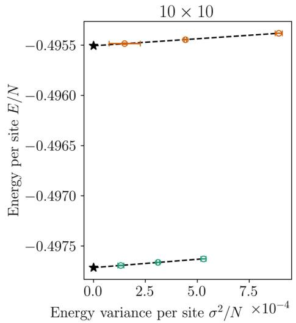
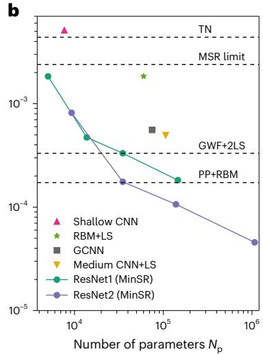
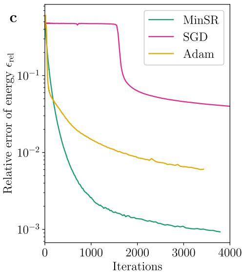

# MinSR 复现记录

本文按体系记录 MinSR 的训练和测量，并与 Chen 和 Heyl 的[论文](Chen-2024-MinSR/paper.pdf)结果对照。

## 能量换算

论文式 (4) 用自旋算符 $\mathbf S$，复现用的 [`Heisenberg`](../quantax/operator/common_operators.py) 用 Pauli 矩阵 $\boldsymbol\sigma$。对自旋 1/2，每个自旋算符都是 $\mathbf S_i=\boldsymbol\sigma_i/2$，每条相互作用键上的两个 $1/2$ 相乘得到 $1/4$：

$$
\mathbf S_i\cdot\mathbf S_j
=\frac14\,\boldsymbol\sigma_i\cdot\boldsymbol\sigma_j,
\qquad
\frac{E_{\mathrm{spin}}}{N}
=\frac{E_{\mathrm{Pauli}}}{4N}.
$$

结果表并列记录每格点能量 $E_{\mathrm{spin}}/N$ 和总能量 $E_{\mathrm{Pauli}}$，其中 $N$ 是对应体系的格点数。与论文比较时用前者，核对日志的 `E` 或测量摘要的 `energy` 时用后者。测量摘要的 `energy_per_site` 已经除过格点数，只需再除以 4。[测量摘要示例 `summary.json`](../runs/j1j2_square_10x10_J1-1_J2-0.5/20261119_150209/summary.json)

## 零方差外推

本征态的能量方差 $\sigma^2=\langle H^2\rangle-\langle H\rangle^2$ 为零。论文 Methods 的 **Zero-variance extrapolation** 一节（式 (30)–(34)）指出，若几个变分态都接近同一个目标本征态，且误差成分的组成相近，能量偏差就近似正比于方差。用 $\sigma^2/N$ 作横轴、$E/N$ 作纵轴拟合直线，横轴为零时的纵截距就是目标扇区最低能量的估计。这里用的是哈密顿量的方差，与蒙特卡洛能量均值的统计误差不同。

以论文扩展数据图 3 的 10×10 方格为例，每个扇区用三组数据拟合：34,944 参数和 139,008 参数的两个 ResNet2 各给出一点，对较大的网络做一步 Lanczos 得到第三点。这一步在原变分态及哈密顿量作用于该态所得向量张成的子空间里重新最小化能量。基态和激发态各自拟合，图中黑色星号标出外推值。下文的复现测量只对固定权重重复采样，没有做 Lanczos 或零方差外推。

图源：[Chen 和 Heyl，论文扩展数据图 3](Chen-2024-MinSR/paper.pdf)的 10×10 面板。

## 10×10 周期方格

体系有 100 个自旋 1/2 格点，$J_1=1$、$J_2=0.5$。普通训练、对称性训练和测量均使用 `msr=True`，在 Marshall 符号基底下计算。Pauli 总能量除以 400 即得论文使用的每格点能量。

### 论文结果和模型配置

图源：[Chen 和 Heyl，论文图 2b](Chen-2024-MinSR/paper.pdf)。横轴是可训练参数量，纵轴是相对能量误差；下表列的是能量值。

下表对应论文图 2b 的 ResNet2（MinSR）。测量脚本 [`measure.py`](../examples/measure.py) 列出了网络结构、可训练参数量和对应的权重文件。每格点能量取自 [`Fig2b.csv`](../data/Fig2b.csv)，最佳变分结果的不确定度和基态参考值来自论文扩展数据表 1。三种网络均为实值 `ResSum`，卷积核为 $3\times3$，`use_sinh=True`，即末端激活为 $\sinh(x)+1$ 后求和。

| 论文结果 | 层数 | 通道 | 参数量 | 权重 | $E/N$ | 总能量 |
| --- | ---: | ---: | ---: | --- | ---: | ---: |
| ResNet2，预设 1 | 16 | 16 | 34,944 | [`square10x10_1616.eqx`](../params/square10x10_1616.eqx) | -0.4976274 | -199.05096 |
| ResNet2，预设 2 | 16 | 32 | 139,008 | [`square10x10_1632.eqx`](../params/square10x10_1632.eqx) | -0.4976619 | -199.06476 |
| ResNet2，预设 3，论文最佳变分结果 | 30 | 64 | 1,071,488 | [`square10x10_3064.eqx`](../params/square10x10_3064.eqx) | -0.4976921(4) | -199.07684(16) |
| 基态参考值，零方差外推 | — | — | — | — | -0.497715(9) | -199.0860(36) |

论文用零方差外推估计这一体系的基态能量，未用精确对角化求这个参考值。表中各组网络的变分能量来自固定权重测量。比较复现结果时，先看论文中同配置网络的变分能量；论文最佳网络的结果和基态外推值另作参照。

### 训练和测量参数

图源：[Chen 和 Heyl，论文扩展数据图 1c](Chen-2024-MinSR/paper.pdf#page=11)。曲线对应约 100 万参数的 ResNet2，使用 10000 个蒙特卡洛样本。

下表的论文设置取自随论文发布的原始示例，复现设置见当前流水线的配置。两个训练示例默认用 16 层、16 通道。测量示例默认直接读取仓库自带的预设 1 权重，可独立运行。图 2b 中各网络是否采用同一训练日程，仅凭这些示例无法确认。[train.py](../examples/train.py) · [train_symm.py](../examples/train_symm.py) · [measure.py](../examples/measure.py) · [run_pipeline.py](../examples/run_pipeline.py)

论文 Methods 的 **Symmetry** 一节在式 (29) 中把已训练的变分态投影到所需的对称性扇区。CNN 已经保证平移对称性，方格上的额外投影使用 $C_{4v}$ 点群和自旋反演。对称性训练读取第一阶段权重，在加入投影后继续更新参数。[train_symm.py](../examples/train_symm.py)

| 阶段 | 论文 `STEPS` / `NSAMPLES` | 复现 `STEPS` / `NSAMPLES` | 步长 | `reweight` | 热化 / 交换 | 对称约束 |
| --- | ---: | ---: | ---: | ---: | ---: | --- |
| 普通训练 | 20000 / 10000 | 2000 / 1000 | 0.001 | 1.0 | 2000/200 | `TotalSz(0)` |
| 对称性训练 | 10000 / 10000 | 1000 / 1000 | 0.001 | 1.0 | 2000/200 | `TotalSz(0) + SpinInverse() + C4v()` |
| 测量 | 100 / 10000 | 100 / 1000 | — | 2.0 | 10000/1000 | `TotalSz(0) + SpinInverse() + C4v()` |

「热化 / 交换」按每条采样链计数：左边是初始热化时尝试交换自旋的次数，右边是每个训练步或测量轮的尝试次数。两套设置的 `MAX_PARALLEL` 均为 32768，交换采样器在第一、第二近邻键上提议交换。两个训练阶段采用[采样器](../quantax/sampler/metropolis.py)默认的 $20N$ 次初始热化与每个训练步 $2N$ 次提议，测量显式改为 $100N$ 与 $10N$。训练按 $|\psi|$ 采样并重加权回 $|\psi|^2$，测量直接按 $|\psi|^2$ 采样，每轮记录能量，不更新权重。

两个训练阶段都用 MinSR 更新权重。实值网络权重默认为 FP32，样本空间矩阵和谱求解用 FP64。默认[伪逆](../quantax/optimizer/solver.py)采用论文式 (23) 的软截断，FP64 下相对阈值为 $10^{-12}$，绝对阈值为 0。复现的训练 `STEPS` 和三个阶段的 `NSAMPLES` 均为论文配套示例的十分之一，测量的 `STEPS` 仍为 100。

### 已完成的复现

各组使用 16 层、3×3 卷积的 `ResSum`，均设置 `use_sinh=True`。RTX 5060 Ti 的 PyTorch 组从保存的 JAX 第 0 步权重起跑，其余各组由对应框架随机初始化。各组用自己的最终对称性权重测量 100 轮。每格点能量按论文的自旋算符口径换算，总能量和中心方差采用 Pauli 口径。总耗时为三个阶段的实测耗时之和。[初始权重、训练统计和验收容差](pytorch-migration-plan.md#完整验收结果) · [稳态耗时](implementation-improvements.md#jax-与-pytorch-耗时对比)

| 设备 | 实现 | 通道 | $E/N$ | 总能量 | 中心方差 | 总耗时 | 归档 |
| --- | --- | ---: | ---: | ---: | ---: | ---: | --- |
| RTX 4070 Ti | JAX | 16 | -0.49696878 | -198.78751226 | 6.20959269 | 7.5 小时 | [普通](../runs/j1j2_square_10x10_J1-1_J2-0.5/20261119_054229/) / [对称](../runs/j1j2_square_10x10_J1-1_J2-0.5/20261119_063326/) / [测量](../runs/j1j2_square_10x10_J1-1_J2-0.5/20261120_022539/) |
| RTX 4070 Ti | PyTorch | 16 | -0.49701357 | -198.80542778 | 5.82108771 | 3.1 小时 | [普通](../runs/j1j2_square_10x10_J1-1_J2-0.5/20261121_123654/) / [对称](../runs/j1j2_square_10x10_J1-1_J2-0.5/20261121_130358/) / [测量](../runs/j1j2_square_10x10_J1-1_J2-0.5/20261121_152043/) |
| RTX 5060 Ti | JAX | 16 | -0.49703860 | -198.81543814 | 5.23723064 | 12.4 小时 | [普通](../runs/j1j2_square_10x10_J1-1_J2-0.5/20261119_030050/) / [对称](../runs/j1j2_square_10x10_J1-1_J2-0.5/20261119_051106/) / [测量](../runs/j1j2_square_10x10_J1-1_J2-0.5/20261119_150209/) |
| RTX 5060 Ti | PyTorch | 16 | -0.49708632 | -198.83452640 | 4.75737444 | 3.8 小时 | [普通](../runs/j1j2_square_10x10_J1-1_J2-0.5/20261122_153201/) / [对称](../runs/j1j2_square_10x10_J1-1_J2-0.5/20261122_160638/) / [测量](../runs/j1j2_square_10x10_J1-1_J2-0.5/20261122_184508/) |
| RTX 4070 Ti | JAX | 32 | -0.49691666 | -198.76666431 | 6.86522626 | 14.7 小时 | [普通](../runs/j1j2_square_10x10_J1-1_J2-0.5/20261120_044916/) / [对称](../runs/j1j2_square_10x10_J1-1_J2-0.5/20261120_064554/) / [测量](../runs/j1j2_square_10x10_J1-1_J2-0.5/20261120_165911/) |

另保留了一组 PyTorch 读取 JAX 最终权重的固定权重测量。[同权重测量归档](../runs/j1j2_square_10x10_J1-1_J2-0.5/20261121_022743/)
